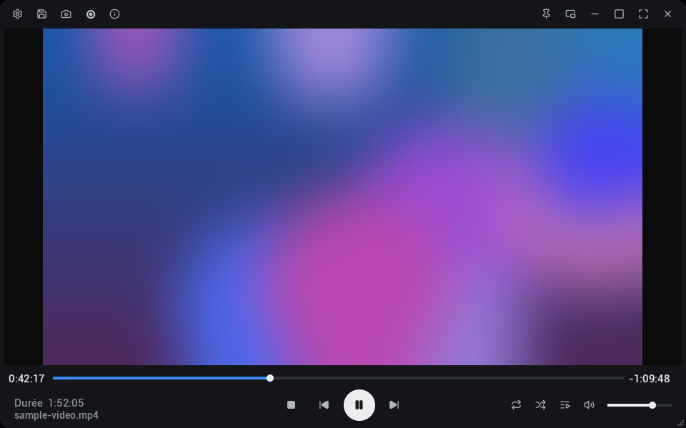
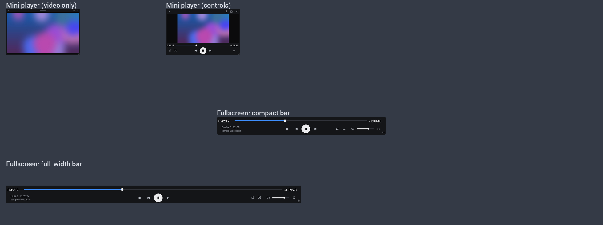

# NearDark

A clean, modern dark skin for **VLC media player** (skins2), with a blue accent, a detachable mini player and a minimal fullscreen bar.





## Features

- Flat dark interface with a `#3D8BFF` blue accent and crisp [Lucide](https://lucide.dev) icons
- Elapsed time, total duration and remaining time
- Separate, resizable playlist window
- Mini player: pinned on top, resizable, video only by default; double-click the top bar (or use the arrow) to show the controls
- Fullscreen: compact floating bar, or a full-width bar docked at the bottom (toggle at the bottom right)
- Quick buttons: open, save playlist, snapshot, record, media info, settings, repeat / repeat one, shuffle, stop, volume
- Drag and drop files onto the player to play them
- Designed for 1080p screens at 100% scaling

## Install

1. Download `NearDark.vlt` from the [Releases](../../releases) page (or from this repo).
2. Windows: copy it to `C:\Program Files\VideoLAN\VLC\skins\`
   Linux: `~/.local/share/vlc/skins2/`
3. In VLC: **Tools > Preferences > Interface**, choose **Use custom skin**, select `NearDark.vlt`, click **Save** and restart VLC.

To go back to the standard interface: right-click the skin > **Interface > Preferences**, then select **Use native style**.

## Build from source

Requires Python 3, Pillow and CairoSVG.

```bash
pip install pillow cairosvg
python3 build.py        # 100% (default)
python3 build.py 1.25   # optional scale for HiDPI screens
```

The skin is written to `out/NearDark.vlt`.

## Known limitations

These come from VLC's skins2 engine, not from the skin:

- Right-click menu does not work in fullscreen.
- Controls cannot appear on mouse hover; the mini player uses double-click instead.
- There is no skin action for **Effects and Filters**: open it from the VLC menu (Tools > Effects and Filters).
- Labels and tooltips are in French.

Tested with VLC 3.0 on Windows.

## License

MIT, see [LICENSE](LICENSE). Bundled third-party assets are listed in [THIRD_PARTY_NOTICES.md](THIRD_PARTY_NOTICES.md).
